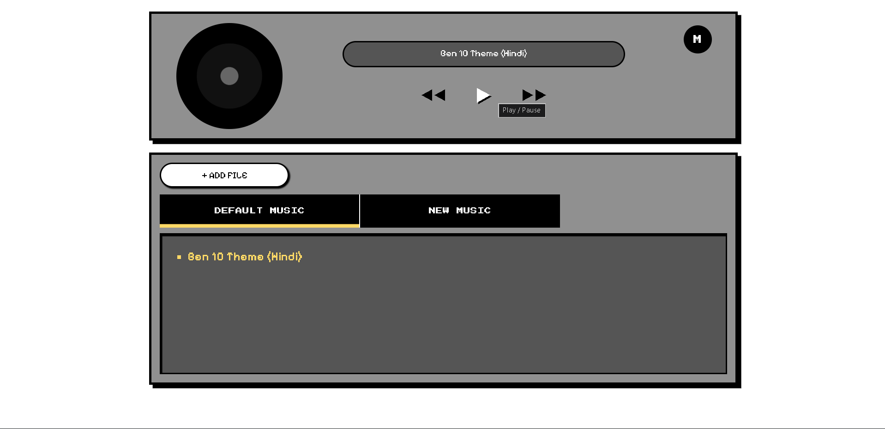
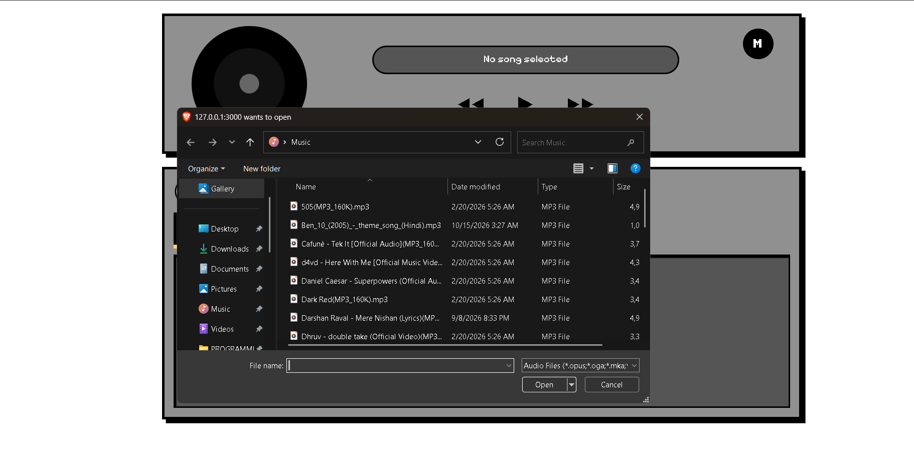
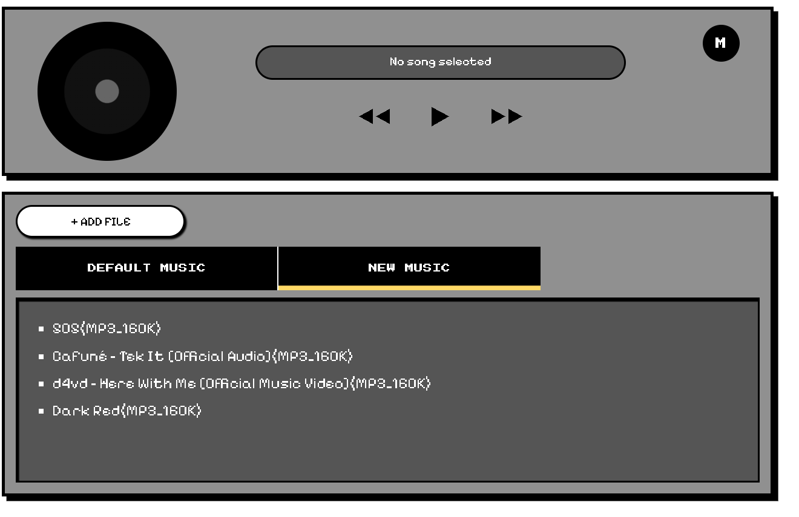

## Pixl Jukebox Music Player

A retro, pixel-style web jukebox built with plain **HTML, CSS, and JavaScript**. Play built-in default tracks, add your own audio files from your device, and control playback with shuffle, repeat, and mute modes, all wrapped in a nostalgic 8-bit interface.



## Features

- **Retro pixl UI** with a spinning disc that rotates only while music is playing.
- **Two music libraries** shown in tabs:
  - **Default Music** tracks bundled with the projects
  - **New Music** tracks added byt the user from there device during the session.
- **Playback controls**: play/pause, previous, and next.
- **Smart Previous**: if a song has played more that 3 seconds, Previous restarts it; otherwise it goes to the previous track.
- **Add Files**: load one or more to add new songs the player
- **Click-to-play** any track on the players.
- **Now-playing** shows the current song name.
- **Mode-Menu 'M'** with:
  - Shuffle ON/OFF
  - Repeat OFF,ALL,ONE
  - Mute ON/OFF
- **Visual feedback** the M button turns red whenever any mode is active; the play button icon toggles between ▶️ and ⏸️.
- **Auto-advance** to the next track when a song ends, respecting the repeat and shuffle settings.
- **Responsive layout** that stacks vertically on small screens

## Screenshots

- Main Interface
  

- Mode menu
  
  

## Tech Stack

Technology

**HTML5**
**CSS3**
**Vanilla JavaScript (ES6+)**
**Google Fonts** `Press Start 2P` and `Pixelify Sans` retro typefaces

No frameworks, build tools, or package managers are required.

### Installation

```
git clone https://github.com/asmitsingh000/Jukebox-Music-Player.git
cd Jukebox-Music-Player
```

or Download zip and extract it 2. afteer the download go to the Jukebox-Music-Player folder. 3. if you want to add the song then add your default songs on the song folder 4. or open index.html present inside the Jukebox-Music-Player folder 5. there you can add songs on that html

## Adding default song

```javascript
const DEFAULT_SONGS = [
  { name: "Ben 10 Theme (Hindi)", src: "songs/ben10.mp3" },
];
```

**To add more songs:**

1. Copy the audio file into the `songs/` folder.
2. Add a new object to the array, separated by a comma:
   ```javascript
   const DEFAULT_SONGS = [
     { name: "Ben 10 Theme (Hindi)", src: "songs/ben10.mp3" },
     { name: "Song Two", src: "songs/song-two.mp3" },
     { name: "Song Three", src: "songs/song-three.mp3" },
   ];
   ```

**Tip:** Use simple file names with no spaces, brackets, or special characters (for example, `ben10.mp3` instead of `Ben_10_(2005)_-_theme_song_(Hindi).mp3`). These can cause loading errors on some servers.

## Known Limitations

- **Session-only library**: files added through **+ ADD FILE** are cleared when the page is refreshed.
- **No progress bar or volume slider**: these are planned for a future version.
- **Tab switching**: if you switch tabs while a song is playing, the playing track keeps playing, but Next and Previous use the newly selected tab's list.
- **Mute is not saved**: mute resets to OFF after a page reload.
- **Shuffle with Repeat OFF**: playback stops once every track in the list has played.

## License

This project is licensed under the **MIT License**. See the `LICENSE` file for details.


##  Author

**Asmit Singh**
- GitHub: [@asmitsingh000](https://github.com/asmitsingh000)
